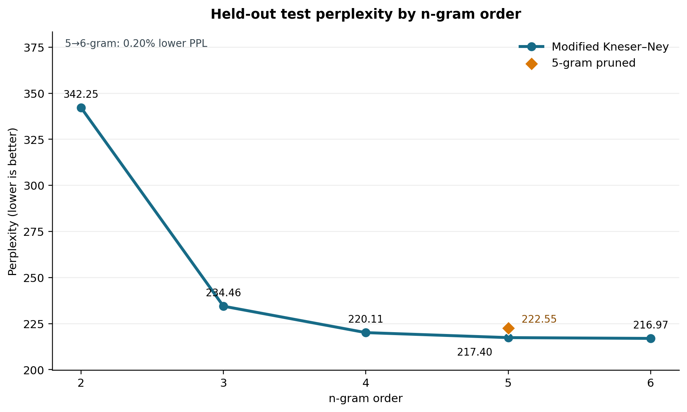
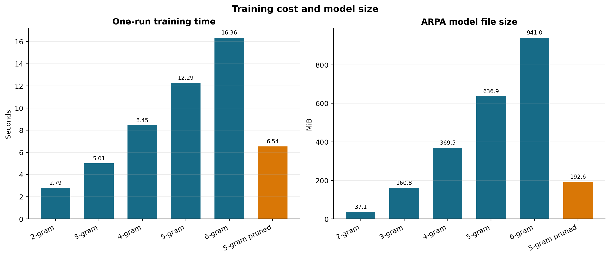
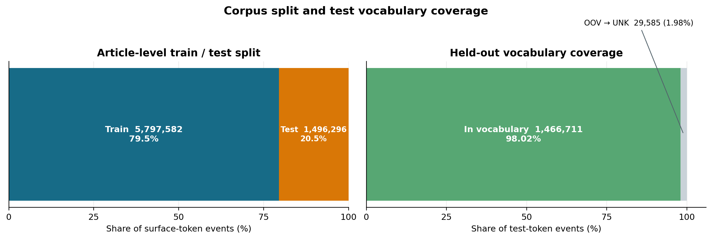
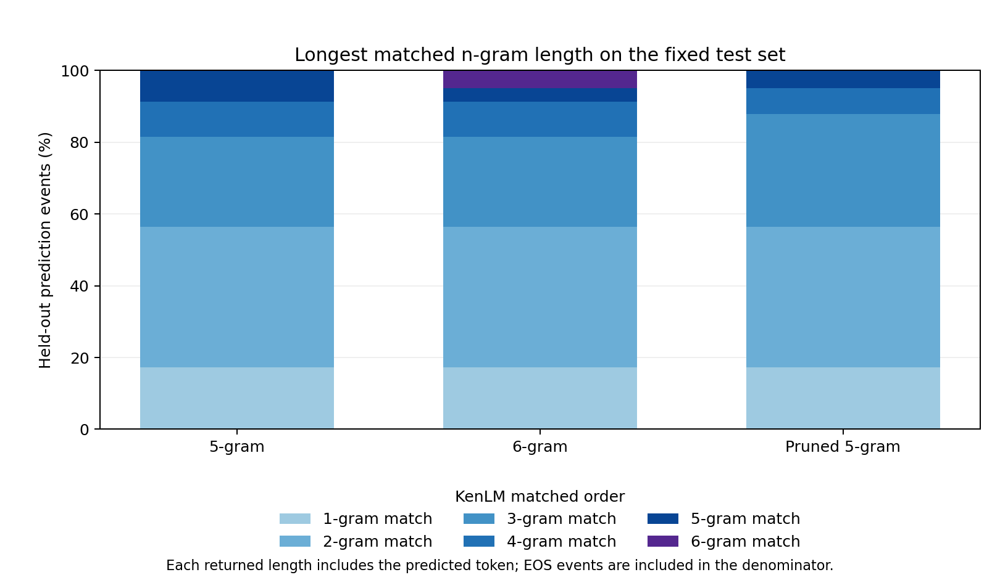

# 《人民日报》词级 n-gram 语言模型的阶数收益与剪枝权衡

## 摘要

本实验考察词级 n-gram 阶数和高阶计数剪枝对《人民日报》语言模型预测效果及模型成本的影响。使用课程提供的 1998 年 1—6 月带音语料，保留空格分词和标点，移除读音与版式标记，并按文章去重后以固定随机种子划分训练集和测试集。所有模型采用 KenLM Modified Kneser–Ney 平滑，在同一训练语料、词表和文章级测试集上训练 2–6-gram，并额外训练一个剪枝 5-gram。测试困惑度从 2-gram 的 342.25282 降至 6-gram 的 216.96751，但 5 阶升至 6 阶仅降低 0.20%，ARPA 文件增大 47.76%。将 5-gram 中计数为 1 的 4-gram 与 5-gram 剪除后，文件缩小 69.76%，困惑度上升 2.37%。测试事件的匹配阶数分布与训练词频—左邻类型对照进一步表明，长匹配覆盖率和词的左邻多样性共同刻画了模型可利用的局部信息。一次固定前缀续写出现主题跳转和不完整搭配。

**代码仓库：[https://github.com/stq1234/LLMandAppliedPractices-n-gram-programming](https://github.com/stq1234/LLMandAppliedPractices-n-gram-programming)。本次实验的代码及相关说明可在该仓库中获取。**

## 1. 引言

词级 n-gram 语言模型以有限长度的前文估计下一个词的条件概率。随着阶数增加，模型可以区分更具体的局部上下文，但高阶计数更稀疏；平滑方法通过折扣已观察到的计数并把部分概率质量分配给低阶分布，以处理未见序列。Kneser–Ney 平滑的关键思想之一，是让回退分布反映词能够出现在多少种不同前文之后，而不只反映其原始频数[1]。后续对多种平滑方法的实证研究也表明，平滑效果会随数据规模、语料和 n-gram 阶数而变化[2]。KenLM 的 lmplz 使用 Modified Kneser–Ney 估计模型；其估计过程和插值实现见 Heafield 等人的工作[3]。

本实验在同一篇章级切分上回答两个问题：提高模型阶数时，测试困惑度的边际变化与存储、训练成本如何变化；对高阶计数进行剪枝时，模型成本和预测效果如何权衡。为解释观察到的变化，进一步统计测试事件上 KenLM 返回的最高匹配阶数，并对比训练词频与不同左邻类型数。固定前缀续写作为补充案例，展示该词级模型的局部生成现象。

## 2. 语料与预处理

数据为课程提供的《人民日报》1998 年 1—6 月带音语料，文本按空格标记词项，一部分词内嵌读音标注。程序采用严格 GB18030 解码，移除花括号读音和“〓”版式符号，保留原有词项顺序、分词边界及标点。重复记录、重复段落和全文相同的文章均去重；严格解码失败或记录编号与正文冲突的文章整体排除。

清理后语料含 18,581 篇文章、123,386 条记录和 7,293,878 个词面 token。按文章键随机打乱后逐篇分入训练集，直至训练记录数达到 80% 的目标；随机种子固定为 20260929。同一文章不会跨越训练集和测试集，切分结果如下。

**表 1. 训练集与测试集样本规模。**

| 数据划分 | 文章数 | 记录数 | 词面 token 数 |
|---|---:|---:|---:|
| 训练集 | 14,802 | 98,722 | 5,797,582 |
| 测试集 | 3,779 | 24,664 | 1,496,296 |

词表只从训练集构建，保留训练频数至少为 2 的词，并加入一个未知词符号，词表共 69,864 项。训练集中 54,141 个低频词面 token 映射到该符号；测试集中有 29,585 个词面 token 不在训练词表中，占测试词面 token 的 1.98%，同样映射到未知词符号。每条记录独立作为模型输入序列，n-gram 不跨记录边界。

## 3. 方法

对一条由 token 构成的序列，链式法则将其联合概率分解为逐词条件概率的乘积：

$$
P(w_1,\ldots,w_T)=\prod_{i=1}^{T}P(w_i\mid w_1,\ldots,w_{i-1}).
$$

完整历史的条件分布难以从有限语料中可靠估计。阶数为 \(n\) 的 n-gram 模型采用有限阶 Markov 近似：

$$
P(w_i\mid w_1,\ldots,w_{i-1})\approx
P(w_i\mid w_{i-n+1},\ldots,w_{i-1}).
$$

也就是用最近 \(n-1\) 个 token 近似完整历史；这是一种便于估计的建模假设，不表示自然语言严格满足有限阶 Markov 性质。对记录开头，KenLM 以 BOS 作为可用历史上下文；每条记录独立输入，不跨记录拼接。若历史 \(h\) 在训练集中出现，未经平滑的最大似然估计为

$$
\begin{aligned}
\widehat{P}_{\mathrm{MLE}}(w\mid h)&=\frac{c(h,w)}{c(h)},\\
c(h)&=\sum_{w'\in V}c(h,w').
\end{aligned}
$$

其中 \(c(h,w)\) 是训练语料中历史 \(h\) 后接目标词 \(w\) 的次数，\(c(h)\) 是该历史出现次数，\(V\) 是可预测符号集合。若历史 \(h\) 出现过但 n-gram \((h,w)\) 未观察到，最大似然估计给它的概率为零；若历史本身未出现，分母为零，MLE 无法为该历史定义条件分布。平滑通过折扣已见计数并为低阶分布留出概率质量来缓解有限数据造成的稀疏性。

### 3.1 Modified Kneser–Ney 估计

对阶数为 \(n\) 的模型，目标词 \(w_i\) 的历史为 \(h_i=(w_{i-n+1},\ldots,w_{i-1})\)。Modified Kneser–Ney（MKN）先从当前阶计数中扣除按计数类别设定的折扣，再把移出的概率质量插值给低一阶模型：

$$
\begin{aligned}
P_{\mathrm{MKN}}(w\mid h)
&=\frac{\max\!\left(c_n^\star(h,w)-D_{n,r(c_n^\star(h,w))},0\right)}{c_n^\star(h)}\\
&\quad+\lambda_n(h)P_{\mathrm{MKN}}(w\mid h'),\\
c_n^\star(h)&=\sum_{w'}c_n^\star(h,w').
\end{aligned}
$$

插值权重等于该历史下被折扣移出的总质量占历史总计数的比例：

$$
\begin{aligned}
\lambda_n(h)
&=\frac{\sum_{\substack{w'\\c_n^\star(h,w')>0}}D_{n,r(c_n^\star(h,w'))}}{c_n^\star(h)}.
\end{aligned}
$$

这里，\(c_n^\star(h,w)\) 是用于第 \(n\) 阶递归的有效计数：最高阶使用训练频数，较低阶使用由不同左扩展构造的续接计数。令 \(\mathcal{G}_{\mathrm{train}}\) 表示训练语料中出现过的高一阶片段集合，则低阶片段 \(g\) 的续接计数可写为 \(N_{1+}(\cdot,g)=|\{u:(u,g)\in\mathcal{G}_{\mathrm{train}}\}|\)，即不同前置 token 的数量；同一左扩展的重复出现只计一次。\(c_n^\star(h)\) 是有效计数对所有候选后续词的和。\(D_{n,r}\) 是第 \(n\) 阶、计数类别 \(r\) 的折扣，类别通常为 1、2 和至少 3 次；\(h'\) 是去掉历史最左侧 token 后的后缀。若历史 \(h\) 未出现，则直接使用低阶分布。递归的 unigram 基分布为

$$
\begin{aligned}
P_{\mathrm{cont}}(w)&=\frac{N_{1+}(\cdot,w)}{N_{1+}(\cdot,\cdot)},\\
N_{1+}(\cdot,\cdot)&=\sum_{v\in V}N_{1+}(\cdot,v).
\end{aligned}
$$

其中 \(N_{1+}(\cdot,w)\) 是训练语料中以 \(w\) 结尾的不同二元组类型数，点号表示对任意 token 求和；分母是不同二元组类型总数。因而，频繁但只接在少数左邻之后的词，与频数相近但出现在许多不同左邻之后的词，会得到不同的低阶平滑依据[1,3]。本实验以 KenLM `lmplz` 训练 2–6-gram，采用其 Modified Kneser–Ney 估计和插值，不单独调整折扣参数；保存的实验元数据记录所有模型均未使用折扣回退值。

### 3.2 阶数、剪枝与续写

剪枝通过移除低频高阶 n-gram 减少模型条目，使缺少相应长序列时的评分更多依赖低阶回退与插值。本实验保留 unigram 至 trigram，并单独考察对 4-gram、5-gram 单例的剪除影响。最高匹配阶数描述一个测试预测事件在模型中直接命中的最长 n-gram，用于观察可用局部上下文的长度。

## 4. 实验设置

### 4.1 模型与资源指标

比较模型包括最高阶数为 2、3、4、5、6 的完整模型，以及一个剪枝 5-gram。各模型使用相同训练文本和训练词表。剪枝 5-gram 使用阈值 0、0、0、1、1：不剪低于 4 阶的计数，并剪除计数为 1 的 4-gram 和 5-gram；该阈值语义与 KenLM lmplz 的定义一致[4]。比较范围由研究问题预先限定为阶数和该剪枝设置，不在测试集上调节其他超参数。

训练耗时记录 lmplz 训练进程的单次墙钟时间，排序内存上限为 2 GB，进程限制为 4 个 CPU 核心。模型文件大小以 ARPA 文件字节数换算为 MiB，作为模型磁盘存储成本指标。每个模型仅训练一次。

### 4.2 评价指标与查询统计

所有模型使用 KenLM 对相同测试记录评分，每条记录计入一个句末事件。困惑度是预测 token 条件概率倒数的几何平均，按全部词面 token 和句末事件的平均负对数概率计算：

$$
\begin{aligned}
\operatorname{PPL}
&=\exp\!\left(-\frac{1}{N}\sum_{i=1}^{N}\ln P(w_i\mid h_i)\right),\\
&=10^{-\frac{1}{N}\sum_{i=1}^{N}\log_{10}P(w_i\mid h_i)},\\
N&=1{,}520{,}960.
\end{aligned}
$$

其中 \(P(w_i\mid h_i)\) 是模型对第 \(i\) 个预测事件给出的条件概率，\(h_i\) 是该事件的历史，\(N\) 是预测事件总数。本实验的 \(N\) 包含 1,496,296 个测试词面 token 事件和每条记录一个 EOS，共 24,664 个句末事件；句首标记 BOS 只提供上下文，不计作预测事件。PPL 越低，表示模型在该测试事件集合上给出的条件概率几何平均越高。每个模型使用同一个测试事件集合。

最高匹配阶数取自 KenLM full_scores 接口返回的长度，并包含当前预测目标词；事件分母包含所有词面 token 和句末事件，句首只作为上下文。该统计与 PPL 相互补充：前者描述命中长度，后者汇总事件概率。

### 4.3 生成案例设置

补充生成使用固定前缀“在阳光明媚的五月，我们学校胜利召开了……”，按训练词表进行最长词面匹配切分。每个模型分别生成一次贪心续写和一次采样续写；贪心对应 top-k=1，采样温度为 0.8、top-k=10。随机种子以 314159 为基准并按模型阶数偏移；至少生成 6 个词后才允许结束，最多生成 24 个词，生成时屏蔽未知词符号。

## 5. 实验结果

### 5.1 阶数、困惑度与资源成本

表 2 显示，在本次固定测试集上，完整模型的困惑度随阶数增加而降低；剪枝 5-gram 的高阶条目数和文件大小则显著低于完整 5-gram。

**表 2. 各模型的最高阶条目数、单次训练时间、ARPA 文件大小与测试困惑度。**

| 模型 | 最高阶条目数 | 训练时间（秒） | ARPA 大小（MiB） | 测试 PPL |
|---|---:|---:|---:|---:|
| 2-gram | 1,469,468 | 2.792 | 37.05 | 342.25282 |
| 3-gram | 3,700,803 | 5.007 | 160.76 | 234.45598 |
| 4-gram | 4,846,621 | 8.455 | 369.54 | 220.11313 |
| 5-gram | 5,196,541 | 12.288 | 636.86 | 217.39763 |
| 6-gram | 5,273,023 | 16.360 | 941.05 | 216.96751 |
| 剪枝 5-gram | 4-gram：351,595；5-gram：199,348 | 6.544 | 192.56 | 222.55348 |

图 1 展示测试困惑度随阶数的变化。2-gram 至 3-gram 的下降最明显；之后的改善逐步收窄。5-gram 到 6-gram 的 PPL 从 217.39763 降至 216.96751，绝对差为 0.43012，相对下降约 0.20%。

图 1：固定文章级测试集上的困惑度。蓝线为完整 Modified Kneser–Ney 模型，橙色菱形为剪枝 5-gram；纵轴显示局部范围以呈现高阶模型间的细微差异。

图 2 显示，每次训练的墙钟时间和 ARPA 文件大小都随完整模型阶数上升。由 5 阶升至 6 阶时，文件增加 47.76% 至 941.05 MiB，单次训练时间由 12.288 秒增加至 16.360 秒。剪枝 5-gram 相对完整 5-gram 将文件缩小 69.76%，训练时间缩短约 46.7%，同时测试 PPL 增加 2.37%。

图 2：各模型单次训练时间和 ARPA 文件大小。两个面板分别使用秒和 MiB 为单位。

图 3 给出训练、测试 token 划分及测试词表覆盖率。测试集 OOV 比例为 1.98%，其余测试词面 token 均可直接由训练词表表示。

图 3：左图以词面 token 数表示训练与测试划分，右图表示测试集中的词表内 token 与映射到未知词符号的 OOV token。

### 5.2 测试事件上的匹配阶数

为观察模型在固定测试集上查询到的最高已见 n-gram 阶数，统计 KenLM 的 full_scores 接口返回的匹配长度。KenLM 官方 Python 示例使用该字段显示匹配到的 n-gram；此处长度包含当前被预测的词，例如 5-gram 匹配表示“4 个历史词加目标词”[5]。事件比例以 1,520,960 个词面及句末预测事件为分母，句末事件纳入统计，句首只作为上下文。表 3 和图 4 汇总 5-gram、6-gram 与剪枝 5-gram 的分布。

**表 3. 固定测试集上各模型最高匹配阶数所占的预测事件比例。**

| 模型 | 匹配 1-gram | 匹配 2-gram | 匹配 3-gram | 匹配 4-gram | 匹配 5-gram | 匹配 6-gram |
|---|---:|---:|---:|---:|---:|---:|
| 5-gram | 17.203% | 39.196% | 25.131% | 9.771% | 8.699% | — |
| 6-gram | 17.203% | 39.196% | 25.131% | 9.771% | 3.736% | 4.963% |
| 剪枝 5-gram | 17.203% | 39.196% | 31.563% | 7.058% | 4.980% | — |

图 4：固定测试集上 KenLM 返回的匹配阶数比例。每个匹配长度包含预测目标词，事件分母包含句末事件。

完整 5-gram 中有 8.699% 的事件匹配到 5-gram；在 6-gram 中，这些事件分为匹配 5-gram 的 3.736% 和匹配 6-gram 的 4.963%，两者之和仍约为 8.699%。这表明 6-gram 在该测试集上额外延长了部分可用上下文，匹配阶数最高的事件占全部事件的 8.699%。剪枝后，匹配 4-gram 或 5-gram 的事件比例从完整 5-gram 的 18.470% 降至 12.038%，而匹配 3-gram 的比例增加 6.431 个百分点。该分布呈现各阶 n-gram 的直接匹配范围；PPL 则汇总折扣、插值与回退后每个事件的概率，二者共同说明阶数与剪枝的影响。

### 5.3 原始词频与左邻类型

为观察原始频次和 Kneser–Ney 续接计数所关注信息的差别，对训练集低频词映射前的 5,797,582 个词面 token 统计词频及紧邻左词类型数。每条记录独立统计，并把记录起始标记作为词首 token 的一个左邻类型。表 4 中的样例限于训练频数至少为 100 且仅由 Unicode 字母构成的词：第一组按“频数/不同左邻数”排序，第二组按左邻类型数排序并排除第一组。

**表 4. 原始训练词频与不同左邻类型数的样例。**

| 词 | 训练频数 | 不同左邻类型数 | 观察到的左邻或说明 |
|---|---:|---:|---|
| 镕基 | 651 | 1 | 朱 |
| 岚清 | 642 | 1 | 李 |
| 锦涛 | 585 | 1 | 胡 |
| 的 | 284,210 | 28,415 | 多种左邻 |
| 和 | 57,971 | 11,560 | 多种左邻 |

前三个词在训练文本中较常出现，但各自只接在一种左邻之后；“的”和“和”则同时具有较高频次和大量不同左邻。以“镕基”为例，651 次出现对应一种续接环境。该语料计数展示了词频与左邻多样性是不同统计量，与 Modified Kneser–Ney 低阶分布利用续接类型的机制相符；表中左邻数刻画续接类型多样性，而非概率值。

### 5.4 固定前缀续写

**表 5. 完整 5-gram、完整 6-gram 与剪枝 5-gram 在固定前缀下的贪心和采样续写。**

| 模型 | 贪心续写 | 采样续写 |
|---|---|---|
| 5-gram | ”，我的选择。 | 而最让人，其中，“我们的家园———地球上的宝贵的思想和行为，并为之 |
| 6-gram | ”，我的家乡，节前工作又特忙，我节后再回去。” | ”的“大欧洲”，“是在玩弄、游戏于法，法律、法规的制定的一系列 |
| 剪枝 5-gram | ”，我的选择。 | 而最重要的是，这一活动，为促进了。 |

该案例呈现出模型对新闻语料局部搭配和标点模式的复用，也显示在校园活动提示下，主题延续与短语完整性仍有改进空间。

## 6. 讨论

在固定随机文章切分上，增加模型阶数持续降低了测试 PPL，但性能收益明显递减；5-gram 到 6-gram 的改善约为 0.20%，而 ARPA 大小增加近一半。因而在本实验语料与资源指标下，6-gram 的轻微 PPL 改善伴随较高的磁盘成本。匹配阶数结果为这一现象提供了上下文：六阶模型把一部分已有五阶匹配提升为六阶匹配，覆盖约 4.96% 的测试事件。结合 PPL 可见，延长局部匹配与每个事件最终概率的变化共同决定困惑度收益。

剪枝结果显示一种直接的容量—预测权衡：移除单例 4-gram 与 5-gram 后，ARPA 文件和单次训练时间下降，PPL 则上升。匹配阶数分布中，4/5-gram 事件减少、3-gram 事件增加，表明更多预测转由较短的可用序列支持；逐事件概率的变化汇总为整体 PPL 差异。训练词频和左邻类型案例也说明，原始频次与续接多样性提供互补信息；“镕基”等受新闻人物固定搭配影响的词与功能词具有不同的左邻分布。

本实验的困惑度对应 1998 年《人民日报》文章随机切分、空格分词和训练词表设定。低频词面被映射为一个未知符号，不同未登录词因此共享同一表示。资源比较采用 ARPA 磁盘大小和单次训练墙钟时间，分别刻画模型文件存储与本次训练开销。

## 7. 结论

在课程提供的《人民日报》1998 年上半年词级语料和固定文章级测试集上，Modified Kneser–Ney 2–6-gram 的 PPL 随阶数增加而下降，但高阶收益递减：5 阶到 6 阶约降低 0.20%，ARPA 文件增加 47.76%。对 5-gram 中单例 4/5-gram 进行剪枝，可将 ARPA 文件缩小 69.76%，代价是测试 PPL 上升 2.37%。匹配阶数统计显示剪枝使部分测试事件转由较低阶匹配；词频—左邻观察则表明，词频与续接多样性描述了不同的上下文信息。

本次实验的代码及相关说明可在该仓库中获取：[https://github.com/stq1234/LLMandAppliedPractices-n-gram-programming](https://github.com/stq1234/LLMandAppliedPractices-n-gram-programming)。

## 参考文献

[1] Reinhard Kneser and Hermann Ney. 1995. [Improved Backing-Off for M-Gram Language Modeling](https://www-i6.informatik.rwth-aachen.de/publications/download/951/Kneser-ICASSP-1995.pdf). In *Proceedings of ICASSP 1995*, pages 181–184. IEEE.

[2] Stanley F. Chen and Joshua Goodman. 1996. [An Empirical Study of Smoothing Techniques for Language Modeling](https://aclanthology.org/P96-1041/). In *Proceedings of the 34th Annual Meeting of the Association for Computational Linguistics*, pages 310–318. Association for Computational Linguistics. https://doi.org/10.3115/981863.981904.

[3] Kenneth Heafield, Ivan Pouzyrevsky, Jonathan H. Clark, and Philipp Koehn. 2013. [Scalable Modified Kneser–Ney Language Model Estimation](https://aclanthology.org/P13-2121/). In *Proceedings of the 51st Annual Meeting of the Association for Computational Linguistics (Volume 2: Short Papers)*, pages 690–696. Association for Computational Linguistics.

[4] Kenneth Heafield. 2011. [KenLM: Faster and Smaller Language Model Queries](https://aclanthology.org/W11-2123/). In *Proceedings of the Sixth Workshop on Statistical Machine Translation*, pages 187–197. Association for Computational Linguistics. See also the [KenLM lmplz source](https://github.com/kpu/kenlm/blob/master/lm/builder/lmplz_main.cc) for pruning-threshold semantics.

[5] KenLM contributors. [Python example: scoring and n-gram matches](https://github.com/kpu/kenlm/blob/master/python/example.py). KenLM source code.
