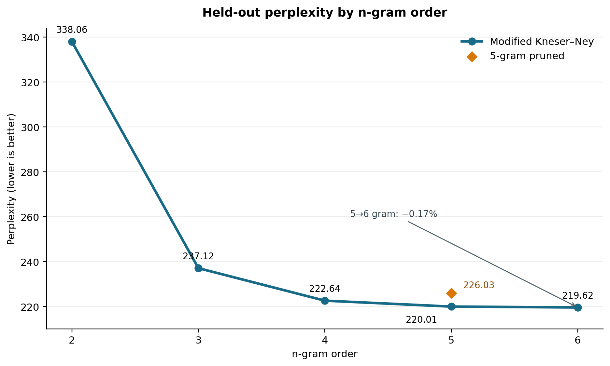
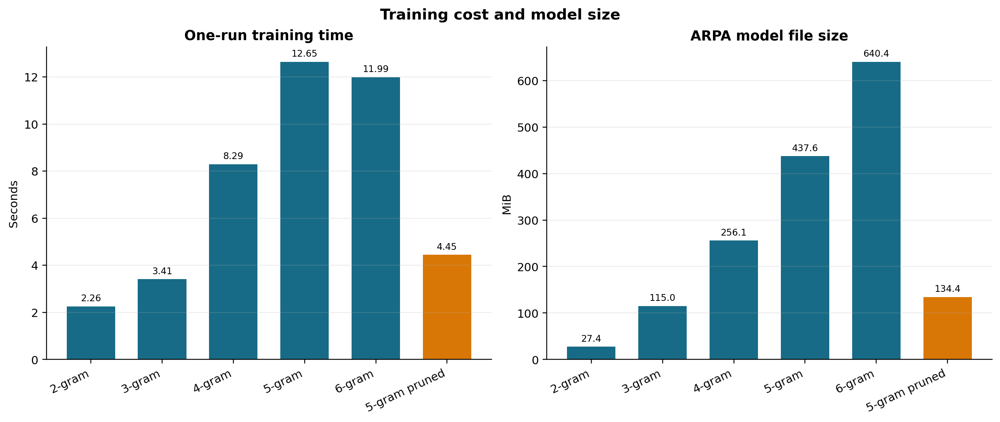
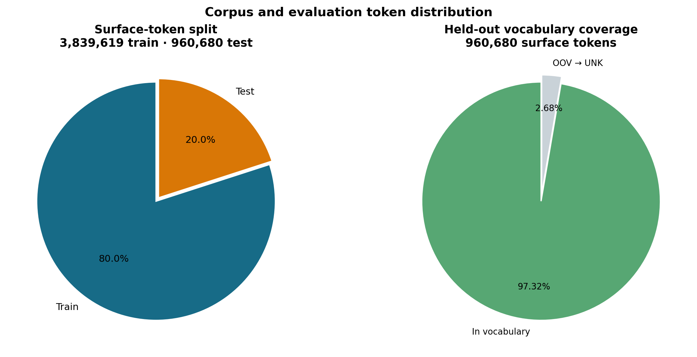

# 《人民日报》1998 年 1—4 月语料上的词级 n-gram 建模实验

## 摘要

本实验对 1998 年 1—4 月《人民日报》分词标注语料进行清洗，按文章划分训练集和测试集，使用 KenLM 的 Modified Kneser–Ney 训练 2–6 gram 词级模型，并比较未剪枝 5-gram、6-gram 和剪枝 5-gram 的困惑度、训练耗时、模型大小及指定前缀续写。

测试集困惑度随阶数上升而下降，但收益逐步变小：5-gram 为 220.005，6-gram 为 219.624，相对降低约 0.17%；与此同时，6-gram ARPA 文件增大约 46%。对 5-gram 剪除低频 4-gram、5-gram 后，文件缩小约 69%，训练耗时下降，但困惑度上升到 226.027。几种模型都能生成局部新闻式搭配，却没有稳定延续“学校召开活动”的主题，说明留出集困惑度下降不等于指定域外前缀下的语义连贯性提高。

## 语料与清洗

语料取自公开的 [PeopleDaily1998 仓库](https://github.com/chenhui-bupt/PeopleDaily1998)。仓库说明介绍了 PFR 人民日报标注语料的制作背景，并称语料是在取得人民日报社新闻信息中心许可的条件下整理。该仓库 About 描述的范围为 1998 年 1—4 月。本实验从归档中读取 `199801.txt` 至 `199804.txt` 四个月份文件，实际记录日期为 1998-01-01 至 1998-04-30；不把词性和结构标签当作模型词汇。来源、所用成员文件校验值及本地复跑方法记录在 `data/SOURCE.md`，结果目录的 JSON 也保存了各月字节数和 SHA-256。报告只列统计和模型结果，不附原始新闻语料。

原始记录以日期和文章编号开头，正文为按空格分隔的“词面/词性”序列，专名组还带方括号与组别标签。清理时保留词面、原始分词边界和标点，去掉记录编号、词性、方括号、组别标签及额外的 `/%` 标注；另移除 1 个非打印控制字符。清理后未留下未识别标注片段。

| 清洗统计 | 数值 |
|---|---:|
| 原始月文件 | 4 份，UTF-8 严格解码 |
| 物理行 / 空白行 | 93,440 / 12,121 |
| 有效记录 | 81,319 |
| 文章数 / 有效日期数 | 12,144 / 120 |
| 保留词面 token | 4,800,299 |
| 移除词性标签 | 4,800,299 |
| 移除组别标签 / 方括号 | 42,328 / 84,656 |
| 移除额外标注 / 非打印字符 | 410 / 1 |
| 未识别标注片段 | 0 |

## 划分与训练设置

以日期、版次和文章编号为分组键，先固定随机种子 `20260929` 打乱文章，再按记录数接近 80:20 划分，避免同一篇文章跨越训练集和测试集。训练集包含 65,072 条记录、9,670 篇文章和 3,839,619 个词面 token；测试集包含 16,247 条记录、2,474 篇文章和 960,680 个词面 token。

词表使用训练集中至少出现 2 次的词。训练集低频词 46,329 个映射为 `__UNK_TOKEN__`；测试集有 25,721 个未登录 token 同样映射为该符号，占测试词面 token 的 2.68%。测试集评分共包含 976,927 个预测事件，即 960,680 个词面 token 加每条记录一个句末事件。

训练器为 [KenLM `lmplz`](https://github.com/kpu/kenlm)，使用默认 Modified Kneser–Ney 概率估计，排序内存上限为 2 GB。2、3、4、5、6 阶模型使用相同的训练文本、词表、测试文本和评分方式。训练日志记录了计数与排序、调整计数、初始概率、插值概率以及 ARPA 写出阶段；所有模型均正常完成，未触发折扣回退。

测试困惑度由 KenLM 对每条测试记录计算并包含句末概率。若各预测事件的 log10 概率和为 L，预测事件数为 N，则 PPL = 10^(−L/N)。训练耗时记录一次 `lmplz` 进程从读取训练文本到写出 ARPA 的墙钟时间，不包含测试评分和续写；单次计时会受到系统缓存和调度影响。

## 阶数与资源结果

| 模型 | 高阶 n-gram 数量 | 训练时间（秒） | ARPA 大小（MiB） | 测试 PPL |
|---|---:|---:|---:|---:|
| 2-gram | 2-gram 1,084,088 | 2.255 | 27.44 | 338.064 |
| 3-gram | 3-gram 2,571,086 | 3.411 | 114.99 | 237.123 |
| 4-gram | 4-gram 3,271,772 | 8.291 | 256.07 | 222.641 |
| 5-gram | 5-gram 3,470,339 | 12.646 | 437.60 | 220.005 |
| 6-gram | 6-gram 3,508,258 | 11.991 | 640.45 | 219.624 |
| 5-gram 剪枝 | 4-gram 217,420；5-gram 122,194 | 4.451 | 134.42 | 226.027 |

剪枝 5-gram 使用 `--prune 0 0 0 1 1`，即在 4-gram 和 5-gram 阶段剪去计数为 1 的项，低阶计数保持不变。下列图表均由本次模型结果 CSV 与实验元数据生成。



图 1：2–6-gram 测试集困惑度折线图。菱形标出剪枝 5-gram；5 阶到 6 阶的相对下降约 0.17%。



图 2：训练耗时与 ARPA 文件大小柱状图。两个面板分别使用秒和 MiB，避免混用量纲。



图 3：训练/测试词面 token 切分，以及测试集中词表内 token 与映射到 UNK 的未登录 token 比例。

从 2-gram 升到 3-gram 后，测试 PPL 大幅下降；4-gram 到 5-gram 的相对下降约 1.18%，5-gram 到 6-gram 又只下降 0.17%（绝对下降 0.381）。因此 6-gram 在本次留出集上确实比 5-gram 略好，属于 n-gram 阶数扩展带来的小幅提升；但其 ARPA 文件由 437.60 MiB 增至 640.45 MiB，增加约 46.35%。该收益较小，且只在一个固定切分上测得，不能据此断言对其他切分也稳定，是否值得部署取决于存储成本。

剪枝 5-gram 的文件比完整 5-gram 小约 69.28%，本次单次训练耗时也更短；代价是 PPL 相对升高约 2.74%。因此剪枝改善的是模型体积与训练速度，不是这组实验中的预测质量。

## 指定前缀续写

统一前缀为：

```text
在阳光明媚的五月，我们学校胜利召开了……
```

按训练词表最长匹配切分为 `在 / 阳光 / 明媚 / 的 / 五月 / ， / 我们 / 学校 / 胜利 / 召开 / 了 / ……`。每个模型均生成一次贪心续写和一次采样续写：贪心为 `top_k=1`；采样温度为 0.8、`top_k=10`，随机种子以 314159 为基数并按模型阶数固定偏移；最少生成 6 个 token 后才允许结束，最多 24 个 token，并屏蔽训练专用的 `__UNK_TOKEN__`。

| 模型 | 贪心续写 | 采样续写 |
|---|---|---|
| 5-gram | ”，所有的人都知道，这是一种“不是一种“不是一种“不 | ”。他们的做法，受到了，但他对此表示感谢。 |
| 6-gram | ”，所有的人都知道，这是一种很好的意见。 | ”。这就要求我们要有新的进展。 |
| 5-gram 剪枝 | ”，不能忘”，“不能忘”，“不能忘”，“不能忘 | ”。他们的做法，并不能证明，人民大会堂，记者在采访一些居委会主任，已成为一 |

6-gram 的贪心结果在局部句法上比 5-gram 少了重复，但仍没有接上学校活动主题；剪枝模型则出现短语循环。采样结果也常转向人民日报新闻中的记者、电头、政治或一般议论表达。训练语料是新闻报道，提示前缀是校园活动叙述，两者分布不匹配；因此这些输出更适合说明模型对高频局部搭配的复用，不应作为主题连贯生成的证据。

## 结论与适用边界

在固定文章级留出集上，提高 n-gram 阶数持续降低了 PPL，但从 5 阶到 6 阶的收益已很有限，文件成本明显上升。对低频高阶项剪枝能大幅压缩 ARPA 文件，却以测试 PPL 上升为代价。就本实验而言，5-gram 是更均衡的预测质量与存储点；若优先追求最低 PPL 且能接受更大的模型，可以选 6-gram，但改善幅度很小。

上述判断只覆盖一个随机文章级切分和这份 1998 年新闻语料。实验没有重复多个随机种子，也没有对校园领域做独立测试。PPL 是词序列预测指标，不直接测量主题相关性、事实性或人类对续写质量的偏好；因此不能把 6-gram 的微小 PPL 改善解释成它解决了长距离语义依赖。

## 实验文件

| 文件 | 内容 |
|---|---|
| `data/人民日报1998_PFR.zip`、`data/SOURCE.md` | 原始归档和来源、编码、选用月份说明 |
| `run_rmrb_experiment.py` | 记录解析、标注清理、文章级切分、KenLM 训练、困惑度与续写 |
| `run_rmrb_experiment_1to4.ps1` | 指定 Jan–Apr 数据、模型阶数和本地 KenLM 环境的可复跑入口 |
| `results_1-4/experiment_results.csv` | 模型训练时间、PPL、ARPA 大小和续写结果 |
| `results_1-4/experiment_metadata.json` | 来源校验、清洗统计、切分、词表和实验参数 |
| `results_1-4/logs/` | 各次 `lmplz` 训练阶段日志 |
| `results_1-4/models/` | 2–6 gram 及剪枝 5-gram 的 ARPA 模型 |
| `results_1-4/perplexity_by_order.png` | 各阶与剪枝模型的测试集困惑度折线图 |
| `results_1-4/resource_comparison_bars.png` | 训练耗时和 ARPA 大小柱状图 |
| `results_1-4/token_distribution_pies.png` | 训练/测试 token 划分与测试集 OOV 比例饼图 |

在实验目录中运行脚本 `run_rmrb_experiment_1to4.ps1` 可重新执行完整流程。脚本临时映射盘符，以规避 Windows KenLM 在中文工作路径下的读取问题，并在结束时解除映射。

代码、复现实验所需的运行入口、结果统计文件与绘图脚本可在 GitHub 仓库中查看：[LLMandAppliedPractices-n-gram-programming](https://github.com/stq1234/LLMandAppliedPractices-n-gram-programming)。
